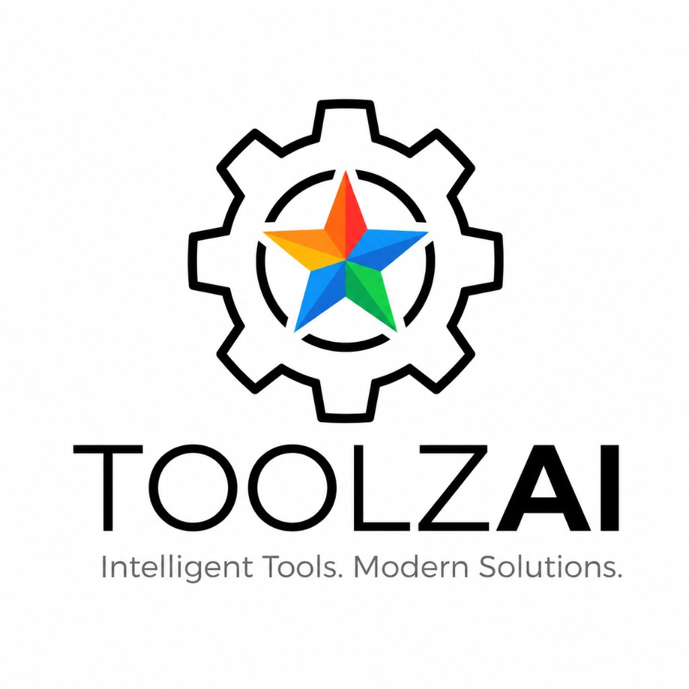

# ToolzAi BD - Authentic Digital Accounts & Software Subscriptions in Bangladesh



**Intelligent Tools. Modern Solutions.**  
ToolzAi BD is Bangladesh's premier storefront for authentic digital accounts, cloud subscriptions, and software licenses with automated instant delivery and 100% replacement warranty.

---

## 🚀 Key Features

- **Complete Catalog of 26 Authentic Products**:
  - **Microsoft & Office**: Microsoft 365 Official (1TB OneDrive), Windows 11 Pro, Office 2024 LTSC Pro Plus, Office 2021 Pro Plus, Google Meet Premium.
  - **AI & Productivity**: Google AI Pro Premium (Gemini Advanced 2TB), ChatGPT Plus, SuperGrok AI, NotebookLM Pro, Grammarly Premium, NanoBanana Pro.
  - **Design & Creative**: Canva Pro 1 Year, Autodesk All Apps Yearly, CapCut Pro 1 Month.
  - **Streaming & Entertainment**: Netflix Premium 4K UHD, YouTube Premium, Amazon Prime 6 Months.
  - **Utilities & Security**: Duolingo Super 12 Months, Truecaller Premium 1 Year, Phone Ads Blocker Lifetime, International Roaming SIM.
  - **Social Growth & Gift Cards**: Meta Verified, Telegram Premium, Follower Service, iTunes Gift Card (USA).
- **Special Flash Offer Countdown**: Live ticker countdown with automatic promo codes (`TOOLZAI10`).
- **Bangladeshi Local Payments**: Integrated checkout for **bKash**, **Nagad**, **Rocket**, **Upay**, and **Binance USDT**.
- **Instant WhatsApp Integration**: 1-click WhatsApp order generator with auto-formatted invoices and 24/7 support line (`+8801886822838`).
- **Interactive Variant Selection**: Choose between personal vs shared subscriptions, durations (1 Month, 6 Months, 1 Year, Lifetime), and device specs.
- **Smart Shopping Cart**: Cart drawer with quantity selectors, promo code verification, and responsive mobile-first UI.
- **Ultra-Fast & Optimized**: Powered by React, Vite, Tailwind CSS, Lucide icons, and sub-80KB gzipped bundle.

---

## 🛠️ Development & Build Setup

### Prerequisites
- Node.js (v18 or higher)
- npm or yarn / pnpm

### 1. Install Dependencies
```bash
npm install
```

### 2. Run Local Development Server
```bash
npm run dev
```

### 3. Build for Production
```bash
npm run build
```
The optimized static build will be placed in the `dist/` directory.

---

## 📱 Support & Social
- **WhatsApp Support**: [+880 1886-822838](https://wa.me/8801886822838)
- **Email**: support@toolzaibd.com
- **Region**: Dhaka, Bangladesh
